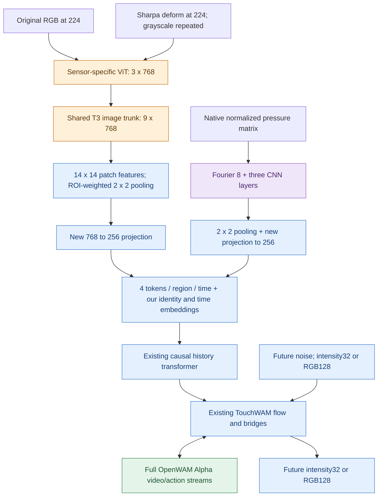

# FTP-1 observation encoders in TouchWAM

This opt-in implementation replaces only the clean-history content encoder.
The RGB/deform prediction codecs, causal history transformer, 67-region registry,
six bridges, flow matching, and full OpenWAM Alpha initialization remain in use.



Orange: FTP-1/T3 architecture and pinned pretrained weights. Purple: FTP matrix
architecture only, explicitly random initialization. Blue: TouchWAM modules and
new spatial adapters. Green: existing OpenWAM Alpha weights.

## Explicit production entry

Use `configs/train_touchwam_ftp1.yaml` and `scripts/train_touchwam_ftp1.sh`.
The older `train_touchwam_pretrain` configuration remains the lightweight route.
The heterogeneous model config pins seven image frontends, the shared trunk,
each SHA256 and each source's official independent normalization statistics.
`TOUCHWAM_FTP1_ENCODER_ROOT` changes the local asset root. Default asset root:

```
/mnt/pfs/v89atp/workspace/models/FTP-1-Tactile-Encoder/d6e5b73e473d3e70fb5f53132a2b1c35b5031156
```

Start from a *new* full-Alpha audit for this configuration:

```bash
python -m scripts.validation.touchwam_alpha_init \
  --config train_touchwam_ftp1 \
  --checkpoint /path/to/OpenWAM-Alpha/checkpoint_step_154000.safetensors \
  --output /path/to/alpha_ftp1_audit.json
TOUCHWAM_ALPHA_AUDIT=/path/to/alpha_ftp1_audit.json \
  bash scripts/train_touchwam_ftp1.sh check
```

The check still requires completed publication, verified actions for robot data,
and the existing data contract. It does not start training or convert data.
After those gates pass, `train` and `resume` retain the same launch semantics as
the previous entry. Exact hours and sampling proportions remain user decisions.

## Data and routing contract

`tactile_maps`/`future_tactile_maps` retain the original prediction dimensions:
one-channel 32-square intensity, three-channel 128-square RGB. New clean-history
fields are:

| Field | Shape before collation | Meaning |
|---|---|---|
| `tactile_observation_maps` | `[T,N,C,Hobs,Wobs]` | Original image/matrix after fixed resizing and [0,1] source normalization |
| `tactile_observation_spatial_valid` | `[N,1,Hobs,Wobs]` | Valid sensor coverage, independent of pixel brightness |
| `tactile_encoder_names` or `tactile_encoder_ids` | `[N]` | Physical encoder family, independently of source identity |

Image observations use 224-square input. Pressure observations preserve explicit
native `[H,W]` declared in the encoder spec. Existing source IDs remain separate:
several datasets can share a GelSightMini frontend while using their own fixed
mean/std. The source+encoder pair must be explicitly registered. RDP and bimanual
RDP contain both GelSightMini and MCTac; their manifest must specify each region's
encoder. A source name cannot determine that choice by itself.

Dataset options `tactile_observation_map_size` and `tactile_encoder_name` enable
the reader path. RGB manifests can use `regions[].encoder_name`; intensity
manifests can use `encoder_names`. Conflicting global/per-region definitions fail.
The readers construct history and future labels independently from native data.
An existing 32-square deform cache cannot be upsampled as a substitute for
224-square original observations; this fails with a clear publication request.
Sharpa can instead use the separately published native-video history index via
`tactile_observation_root`: crop its existing 240-square fingertips to obtain
224-square history online, while retaining the existing 32-square future labels.
See [native Sharpa history](../data/sharpa_native_history.md) for the metadata-only
PFS release and its required source directories. No native media are reconverted.

RGB is pixel appearance, not pressure. The data contract stays [0,1]; the encoder
performs `2*x-1` followed by the exact source-specific pretrained mean/std.
Sharpa uses FTP's SharpaWave initialization and statistics as a *domain-transfer
candidate*. Its physical equivalence to the native SDK deform image is not
established by matching names or shapes. No per-frame min/max or RGB-to-depth
reconstruction is performed.

One sample/microbatch still uses one output codec and one observation spatial
shape. RGB fingers mixed with pressure palms inside one sample remain unsupported.
Different encoders with the same representation and shape can share a batch.
Full-hand region counts remain variable; only present regions allocate tokens.

The default model contains an explicitly initialized `NormalizedPressure` 4x4
single-channel frontend, but no unverified source is mapped into it. FTP RH20T7
uSkin's original 4x4x3 vectors are **not** assumed to be a scalar pressure matrix;
that data entry is disabled until its scalar physical conversion is defined.

## Initialization, optimization and compatibility

FTP checkpoint files are hash checked and exact-key/shape loaded. Only the known
768-to-512 CLS projection in the shared checkpoint is excluded. The final trunk
normalization is retained; frontend/trunk LayerNorm epsilons are 1e-6/1e-5,
matching the upstream implementations. No missing file, sensor, or key silently
falls back to random weights. Explicit `initialization: random` exists for tests
and deliberate scratch experiments only.

By default pretrained image frontends and trunk are frozen. The new spatial
projection, pressure CNN and existing TouchWAM modules are trainable. Setting
`freeze_pretrained: false` enables finetuning. Distinct optimizer groups preserve
unused sensor weights, momentum and weight decay across accumulation and ZeRO.
Activation uses observations after layout/ROI/dropout/nonfinite masking and is
unioned across ranks. Future codec heads are independently activated.

The clean observation encoder runs once before the denoising loop and before CFG
duplication, then the cached history is reused for all steps. Full checkpoints
include the encoders and initialization marker and do not need external FTP
files to resume/deploy. Old lightweight checkpoints remain usable with their
original configuration; changing to this topology is a new initialization/run,
not an exact training-state resume.

## Parameters and verification scope

Seven image frontends plus shared trunk reuse **217,836,288** parameters.
The complete observation module has **237,255,936** parameters, including
**19,419,648** new trainable spatial/pressure parameters. The existing TouchWAM
flow is additional (~37.96M; one added source embedding row adds 256 parameters).
The resulting tactile total is about **275.21M = 0.275B**. Each physical finger
shares its sensor family's frontend; finger count does not multiply weights.

Tiny deterministic CPU integration tests cover deform, RGB and native pressure
backward, causal history, missing/ROI masks, strict asset loading, freezing,
prediction resolution and one observation pass across generation/CFG. The
production trainer smoke supports `--heterogeneous` for bounded single-GPU
ZeRO-2 training and exact optimizer/scheduler resume. Neither substitutes for
the pending full-model multi-GPU run on published real data.

See `THIRD_PARTY_NOTICES.md` for upstream licenses and attribution.
