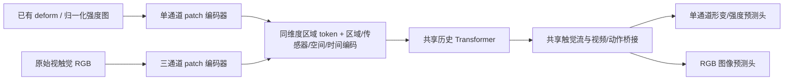

# 原始视触觉与形变图的共享触觉流

本版在 `4b6b4fa` 的训练实现上增加原始光学触觉 RGB 接口。已有 Sharpa deform／压力强度数据继续使用单通道入口；只有 RGB 的传感器直接使用其图像，不以实验重建的 deform 作为必需监督。公共区域注册表仍为 `touchwam_regions_67_v2`，不增加 surface_id。

## 表征与网络



默认预训练配置：

| 项目 | 单通道入口 | 光学 RGB 入口 |
| --- | --- | --- |
| codec | `tactile_intensity_v1`，兼容原 `sharpa_deform_gray_v1` | `tactile_rgb_v1` |
| 输入数值 | 来源定义的接触／形变强度 `[0,1]` | RGB `uint8 / 255`，图像像素 `[0,1]` |
| 训练图大小 | `1×32×32` | `3×128×128` |
| patch 大小 | `16×16` | `64×64` |
| 每区域每时刻共享 token | 4 | 4 |
| token 维度 | 256 | 256 |
| 预测标签 | 同来源、同定义的未来强度图 | 同传感器的未来 RGB 图 |

RGB 的缩放是图像尺寸适配，原始发布视频保持不变。RGB 的 `[0,1]` 表示像素值范围，不表示压力、力或形变深度。这里没有做背景差分、灰度替换、压力反演或逐帧 min-max。

编码器采用独立的 patch 投影和预测头，共享历史编码器、区域／传感器嵌入及触觉桥接模块。它借鉴 FTP 的异构入口／共享 token 思路，**没有加载 FTP/T3 的预训练编码器，也不是复制 FTP 的 3+9 层网络**。图像入口的初始目标是贯通原图输入与未来图预测；纹理细节、滑动表征和策略收益仍需真实训练验证。

输入头按表征类型共享，传感器差异通过身份嵌入提供；目前不是每个数据集一套网络。两种表征的 patch 数必须相同，保证公共区域进入共享层时 token 数和宽度一致。可同时调节两类 patch 大小增加 token 数，但需要新的模型配置与训练。

## 数据与缺测

RGB reader 直接读取已发布 LeRobot v3 的触觉视频和有效性列，使用 [RGB 数据合同](../data/tactile_rgb_contract.md) 定义区域、传感器、方向、ROI、时间和 episode 布局。不需要重新转换原有 RGB 视频，也不需要生成 deform 标签。

历史图像按因果时间选择，未来标签必须来自当前时刻之后。当前帧、视频偏移和 episode 边界按同一时钟对齐。ROI 是单通道空间 mask，作用于全部 RGB 通道。有效黑帧仍是观测；丢包和未覆盖区域通过独立 mask 表达。布局／预测请求／历史有效性／未来标签有效性继续独立。

本轮一份来源 bucket 使用一种触觉表征；同一个全局 microbatch 不混合 RGB 与强度图。它们可在连续 microbatch 及同一梯度累积窗口内共同训练。一个样本中同时包含 RGB 指尖与压力掌面的异构组合尚未定义，不能通过填充通道悄悄拼接；需先定义多表示布局接口。

机器人仍必须有真实动作监督；RGB 入口不放松 [动作合同](../data/robot_action_contract.md)。ego V/VT、机器人 VA/VAT 的规则保持不变。FTP Sharpa 仍按用户当前范围排除；原生 Sharpa 十指仍走已有 deform 路线。没有强度图的压力／力数据不会被当成 RGB。

## 训练、生成与兼容

未来 RGB 使用其独立输出头做图像空间 flow matching；未来强度图继续使用原输出头。两者在各自有效像素内按区域归一化，RGB 不使用“亮度越高、接触越强”的前景加权。不能把 RGB 图像误差解释为压力误差。

采样器按模态与 codec 对齐全局 microbatch，跨 rank 校验相同计算分支。优化器将共享触觉参数、单通道头与 RGB 头分组，活跃状态在梯度累积窗口中取并集；未使用分支不应因 Adam 动量或 weight decay 更新。

生成接口显式接受 `tactile_codec="tactile_rgb_v1"`，输出三通道预测和表示身份。默认旧调用仍走原单通道入口。评估保存 RGB PNG／完整通道 NPZ，按同一有效 mask 比较预测、零图与最后观测保持基线。

旧模型配置默认不开启 RGB，保持原参数名称和加载行为。多源预训练配置显式启用 `rgb_enabled: true`，只在 `touch_v2` 下增加输入／输出适配参数，完整 OpenWAM 初始化规则保持不变。增加 RGB 分支改变模型配置摘要，旧 Alpha 审计不能直接充当新配置的审计；新配置需重新运行 `scripts/validation/touchwam_alpha_init.py`。

旧强度图 checkpoint 可以按原配置加载模型权重；历史训练的严格恢复还要求数据合同一致，新增的表征合同字段可能使旧运行被明确拒绝。不能把新增 RGB 参数的模型当作原训练的严格优化器恢复。此次目标仍是从完整 OpenWAM Alpha 初始化多源训练。

## 验证入口

```bash
# 四种训练模态、RGB/强度图交替、生产 ZeRO-2 训练器、中断恢复；不加载完整 Alpha。
PYTHONPATH=. python -m scripts.validation.touchwam_trainer_smoke \
  --rgb --phase-timeout-seconds 90 --output /tmp/touchwam-optical-smoke-fresh
```

CPU 回归、单卡小模型与完整 Alpha 权重审计各自验证不同范围；它们不代替真实数据的完整模型多 GPU 短训练，也不证明 RGB 分支已获得任务收益。
